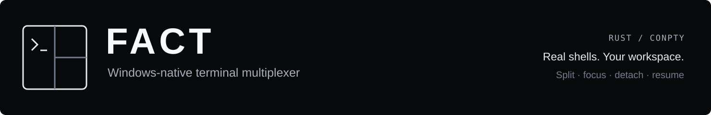
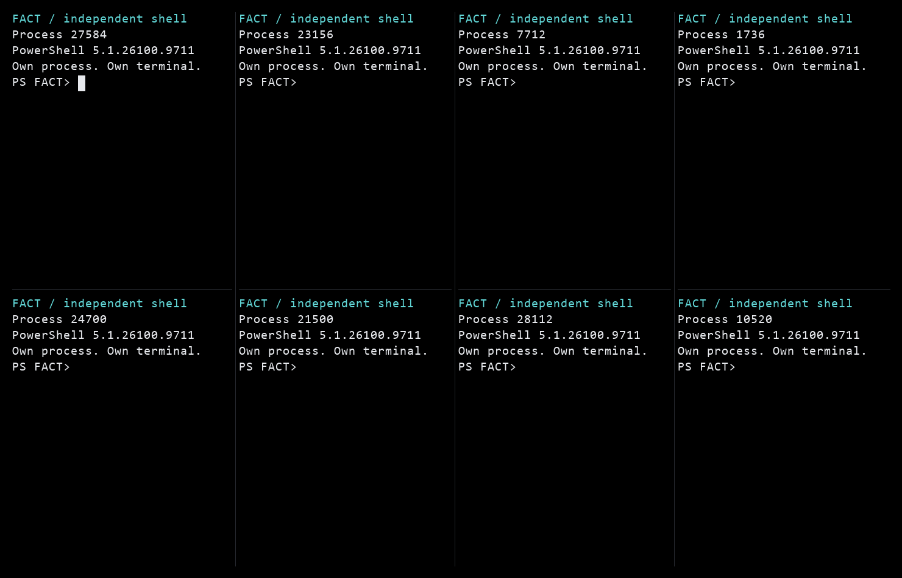
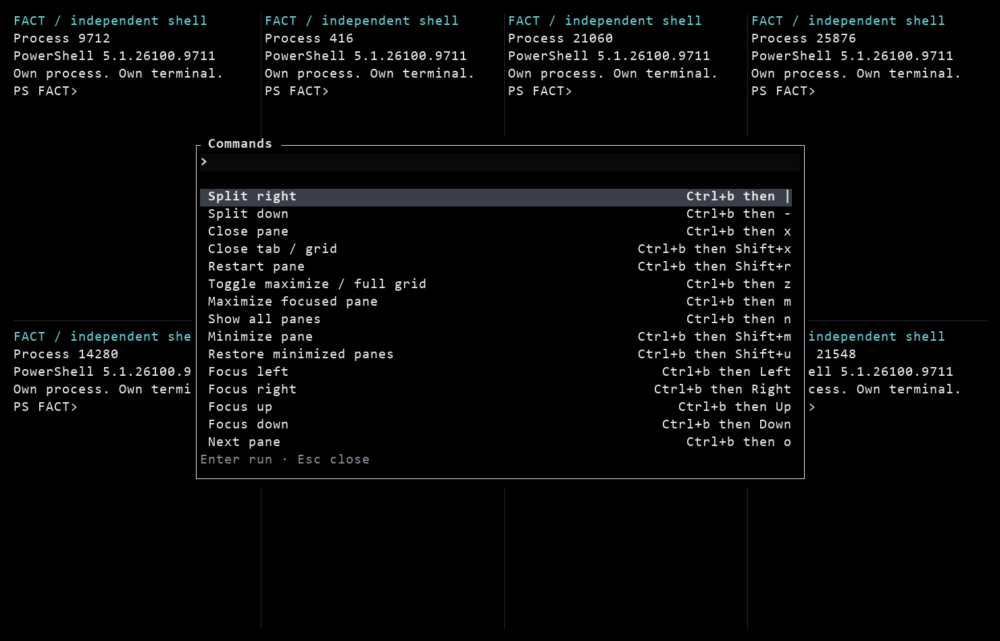
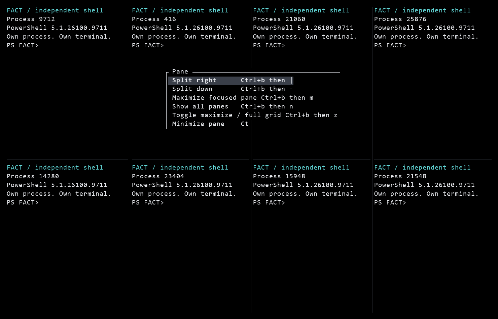
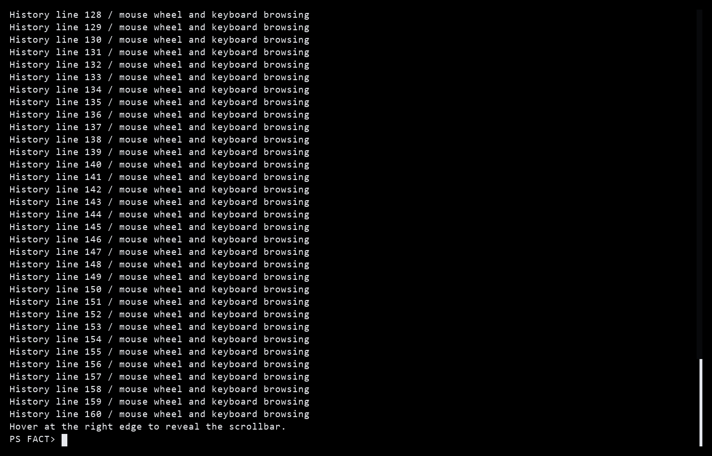
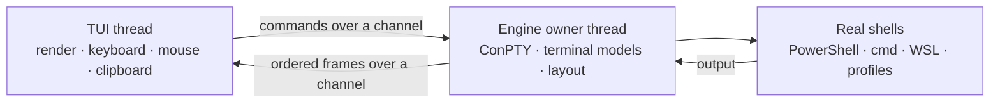

# FACT

<p align="center">
  
</p>

<p align="center">
  <a href="https://github.com/imthegoodboy/FACT/actions/workflows/ci.yml"></a>
  &nbsp; <strong>Windows · Rust · MIT</strong>
</p>

<p align="center">
  <a href="#install">Install</a> ·
  <a href="#everyday-use">Get started</a> ·
  <a href="#keyboard-shortcuts">Shortcuts</a> ·
  <a href="#screenshots">Screenshots</a> ·
  <a href="docs/configuration.md">Configure</a> ·
  <a href="docs/architecture.md">Architecture</a>
</p>

FACT is a Windows-native terminal workspace written in Rust. It runs real
ConPTY shells with tabs, nested splits and grids in one ordinary terminal
window. Everything lives in the `fact.exe` process: close FACT and every shell
it owns closes with it. There is no background daemon and nothing is saved.



*One `fact --grid 8` workspace. Eight independent ConPTY shells. Each pane above
shows its actual process ID. [Explore the controls ↓](#screenshots)*

> **Status:** pre-1.0. Windows 11 is the primary, continuously tested target.
> Windows 10 1809+ is intended to work but is not yet verified; see
> [Compatibility](#compatibility). Release artifacts are produced only from
> version tags after every gate in this repository passes.

## Highlights

- **Built for AI agent CLIs.** Claude Code, Codex, OpenCode and Copilot get
  the keys you press: FACT speaks ConPTY's win32-input-mode and the kitty
  keyboard protocol, so `Shift+Enter` adds a line instead of submitting and
  `Ctrl+Backspace` deletes a word. Outside the prefix, FACT only handles F1 and
  the clipboard keys (each can be set to `none`), `Esc` reaches the agent unless
  a selection, overlay or scroll mode is open, and image paste still works.
- **Light.** One ~2.5 MB native `fact.exe`. Idle workspaces use no CPU: the
  screen is redrawn only when something changes, and shell output wakes the
  engine directly instead of a polling timer.
- **Real shells, not fake panes.** `fact --grid 8` starts eight independent
  ConPTY processes. Each pane has its own PID, terminal state, exit code and
  scrollback.
- **One process, no hidden state.** There is no daemon, named pipe, SQLite
  database or saved layout. Shells are children of the FACT process. Closing the
  UI, quitting with the prefix shortcut or closing the last tab ends them all.
- **Tabs, splits and grids.** Binary split tree, focus, zoom, minimize, move and
  swap. Drag dividers to resize (double-click to balance), `Alt`+drag a pane
  onto another pane or tab to move it, drag tabs to reorder them, or resize from
  the keyboard with the prefix and `Shift`+arrows.
- **Wallpaper and video.** `fact wallpaper set sky.jpg` or `fact wallpaper set
  clip.mp4` puts a picture or a looping video behind every pane, in any
  terminal: Windows Terminal, the classic console, VS Code. In Windows Terminal,
  `fact` opens a FACT tab where pictures are full resolution; elsewhere (and
  with `fact --here`) FACT paints them with block characters. Text, the cursor
  and selections stay readable on top. Changes show in running FACT windows at
  once, and prefix then `B` hides the wallpaper (pausing a video).
- **Your colors.** Five built-in themes, plus a `[colors]` table in
  `config.toml` for your own background, text, accent and selection colors.
- **Minimal black TUI.** Plain terminal panes with no title rows, buttons or
  permanent status bar. A one-line tab strip appears only when the workspace
  has more than one tab. Panes have a scrollbar on hover in shells, a steady
  cursor, keyboard/context-menu actions, a command palette, pane search, five
  themes and F1 help.
- **PowerShell-style mouse and clipboard behavior.** Drag selects, double-click
  selects a word, triple-click selects a line, right-click copies a selection or
  pastes when there is none, and `Shift`+right-click opens FACT's pane menu.
- **Local-only by construction.** No network listener, no service, no elevation
  requirement and no control channel outside the process. Configuration is
  ordinary local TOML.

## Install

**npm (recommended).** The package contains the native `fact.exe`; Node.js is
only used to install it, never at runtime.

```powershell
npm install -g fact-terminal      # install
npm install -g fact-terminal@latest   # update
npm uninstall -g fact-terminal    # remove
fact --version
```

Requirements: Windows 11 x64 (Windows 10 1809+ is expected to work but is not
verified; see [Compatibility](#compatibility)), any terminal. Video wallpapers
also need [ffmpeg](https://ffmpeg.org) (`winget install ffmpeg`).

**PowerShell installer.** Releases also ship a single `fact.exe`, SHA-256
checksums and PowerShell install scripts:

```powershell
# Downloads the latest release, verifies SHA256SUMS.txt, installs per user.
powershell -ExecutionPolicy Bypass -File .\scripts\install.ps1

# Remove the program but keep your configuration.
powershell -ExecutionPolicy Bypass -File .\scripts\uninstall.ps1

# Remove the program and %LOCALAPPDATA%\FACT (configuration).
powershell -ExecutionPolicy Bypass -File .\scripts\uninstall.ps1 -PurgeConfig
```

The installer does not require administrator rights. From a checkout, install a
locally built binary with:

```powershell
cargo build --release --bin fact
.\scripts\install.ps1 -BinaryPath .\target\release\fact.exe -Force
```

Use one install method. If both npm and the PowerShell installer put a `fact`
on PATH, the first one wins; `fact doctor` lists every copy. Close every running
FACT window before replacing the executable. Because there is no background
process, a new window always starts with fresh shells.

## Build from source

Requirements:

- Windows 11 (primary) or Windows 10 1809+
- Rust stable, MSVC target (`rustup default stable-x86_64-pc-windows-msvc`)
- PowerShell 7 or Windows PowerShell 5.1

```powershell
cargo build --release --bin fact
cargo run --bin fact -- --grid 4
```

## Everyday use

```powershell
fact                              # one shell
fact --grid 8                     # eight shells in a grid
fact --profile pwsh --grid 4      # use a configured shell profile
fact --cwd . --grid 1             # start the initial shells in this directory
fact doctor                       # check terminal, config, duplicate installs and agent CLIs
fact wallpaper set C:\Pictures\sky.jpg   # background picture, in every terminal
fact wallpaper set C:\Videos\rain.mp4   # looping video background (needs ffmpeg)
fact wallpaper set --opacity 50   # adjust the current wallpaper in place
fact wallpaper clear              # back to the theme background
fact config path                  # print the configuration file in use
fact config validate              # parse and validate configuration
fact config init                  # write a documented default config.toml
```

`--grid N` accepts 1-32 and always starts a fresh workspace. There is no
resume, attach, detach, saved layout or session name to remember. If you want
the same arrangement again, launch FACT with the same options.

Inside the TUI the default prefix is `Ctrl+Space`. Press `F1` for the full,
remappable keybinding list. `Ctrl+Space k` opens the command palette and
`Ctrl+Space /` searches the focused pane's visible screen and scrollback.

There are no per-pane buttons. Use `Ctrl+Space` then the action from F1 help, or
`Shift`+right-click a pane for split, maximize/show-all, minimize, restart,
close, search and copy. Set `alt_shortcuts = true` for direct `Alt+M` (maximize),
`Alt+N` (show all) and `Alt+T` (close tab); they are off by default because
agents and readline use those chords.

`Ctrl+Space` then `[` enters scroll mode for the focused pane; use arrows,
PgUp/PgDn or Home/End and press Esc to return. In a shell this browses FACT's
searchable history. A full-screen app owns its viewport, so the same gestures
page the app's own transcript.

`Ctrl+C` copies a selection, `Ctrl+V` pastes, and `Ctrl+Shift+C` /
`Ctrl+Shift+V` remain available alongside `Ctrl+Insert` / `Shift+Insert`.
Right-click also copies a current selection; with no selection it pastes into a
shell. When an application captures the mouse, right-click is forwarded to the
application unless you hold Shift, which always opens FACT's menu.

Mouse wheel scrollback works in shells. Hover near a pane's right edge to reveal
its scrollbar, then click or drag it. Moving away hides it after any active drag
ends. Use `Shift`+drag to select text when an app captures the mouse. Selection
holds that pane's visible output steady while the process keeps running. `Esc`,
typing, or scrolling resumes the live view.

### Full-screen apps and agent CLIs

FACT adds no scrollbar to alternate-screen or mouse-controlled applications.
Agent-owned scrollbars remain under the agent's control. Terminal content uses
the full pane width; the shell history scrollbar overlays the last column only
while hovered or dragged. The wheel, Shift+wheel in a main-screen app, and
`Ctrl+Space` then `[` still browse full-screen apps, forwarding mouse reports or
page keys as appropriate.

Agent CLIs can use a private alternate screen. For terminal history with FACT
search, choose an inline/main-screen mode supported by your agent:

- **Codex:** `codex --no-alt-screen` ([CLI reference](https://developers.openai.com/codex/cli/reference/)).
- **Claude Code:** `/tui default` selects its classic renderer; background agent-view
  sessions remain fullscreen ([renderer settings](https://code.claude.com/docs/en/env-vars)).
- **OpenCode / OpenTUI:** set `OTUI_USE_ALTERNATE_SCREEN=false` before launching
  ([renderer source](https://github.com/anomalyco/opentui/blob/main/packages/core/src/renderer.ts)).

Their output then flows into FACT's scrollback instead of a private alternate
screen.

Keyboard: FACT forwards keys the way Windows Terminal does (win32-input-mode)
and answers the kitty keyboard protocol that Claude Code, OpenCode and Copilot
request, so `Shift+Enter` inserts a new line in their prompts and `Esc`
interrupts them. `Ctrl+V` pastes text; with an image on the clipboard it goes to
the agent so it can attach the image. Press the prefix twice to send
`Ctrl+Space` itself. `fact doctor` lists the agents it finds with a tip for
each.

## Keyboard shortcuts

The prefix is armed for one command. With the default `Ctrl+Space`, press and
release it, then press the command key. A single prefix press is never sent to the
shell. All bindings in the first table are configurable in `[keybinds]`; F1
help and the palette always show the compiled values.

| Action | Default shortcut |
| --- | --- |
| Split right | `Ctrl+Space` then `\|` |
| Split down | `Ctrl+Space` then `-` |
| Close pane | `Ctrl+Space` then `X` |
| Close tab / grid | `Ctrl+Space` then `Shift+X` |
| Restart pane | `Ctrl+Space` then `Shift+R` |
| Toggle maximize / full grid | `Ctrl+Space` then `Z` |
| Maximize focused pane | `Ctrl+Space` then `M` |
| Show all panes | `Ctrl+Space` then `N` |
| Minimize pane | `Ctrl+Space` then `Shift+M` |
| Restore minimized panes | `Ctrl+Space` then `Shift+U` |
| Focus left / right / up / down | `Ctrl+Space` then the arrow key |
| Next pane / previous pane | `Ctrl+Space` then `O` / `I` |
| New tab | `Ctrl+Space` then `C`, or click `+` in the tab strip |
| Next tab / previous tab | `Ctrl+Space` then `Shift+N` / `P` |
| Rename tab | `Ctrl+Space` then `Shift+T` |
| Command palette | `Ctrl+Space` then `K` |
| Search focused pane | `Ctrl+Space` then `/` |
| Browse scrollback | `Ctrl+Space` then `[` |
| Copy selection | `Ctrl+Shift+C`, or `Ctrl+C` with a selection |
| Paste clipboard | `Ctrl+Shift+V`, or `Ctrl+V` |
| Swap with next pane | `Ctrl+Space` then `W` |
| Move pane to next tab | `Ctrl+Space` then `Shift+O` |
| Resize: move the focused pane's edge | `Ctrl+Space` then `Shift`+arrow |
| Balance pane sizes | `Ctrl+Space` then `=` |
| Cycle color theme | `Ctrl+Space` then `T` |
| Help | `F1` |
| Quit FACT and close every shell | `Ctrl+Space` then `Shift+Q` |

Direct keys and mouse gestures:

| Input | What it does |
| --- | --- |
| `Alt+M` / `Alt+N` / `Alt+T` | Maximize / show all / close tab, only with `alt_shortcuts = true`. Otherwise they reach the app. |
| Prefix twice | Send the prefix chord itself to the focused app (a single press is withheld). |
| `Ctrl+C` | Copy the visible selection. With no selection it is sent to the shell as normal Ctrl+C. |
| `Ctrl+V`, `Ctrl+Insert`, `Shift+Insert` | Paste clipboard text into the focused pane. With an image on the clipboard, `Ctrl+V` goes to the app. |
| `Ctrl+Shift+C` / `Ctrl+Shift+V` | Remappable copy / paste bindings. |
| `Esc` | Clear a selection overlay, close FACT overlays, or leave scroll mode and return to live output. With F1 help open, `Esc` reaches the focused pane (help closes with `F1` or `q`). |
| Drag in a pane | Select text. |
| Double-click / triple-click | Select the word / visual line under the pointer. |
| `Shift`+drag | Select text even when the application requested mouse reporting. |
| Right-click | Copy the current selection, otherwise paste. In mouse-aware apps the click is forwarded instead. |
| `Shift`+right-click | Open FACT's pane menu, even in mouse-aware apps. |
| Wheel | Scroll shell history or forward the wheel to a mouse-aware app. |
| `Shift`+wheel | Browse FACT history in a main-screen app that captures the mouse. Alternate-screen apps still receive the wheel. |
| Drag a split gutter | Resize adjacent panes. Double-click it to balance every pane in the tab. |
| `Alt`+drag a pane | Drop it on another pane to swap, or on a tab to move it there. |
| Click a tab / `+` | Select a tab / open a new tab when the strip is visible. |
| Drag a tab | Reorder tabs. |
| Click the `▾ N` tray | Restore minimized panes. |

`Ctrl+Space` then `[` scroll mode: Up/Down scroll one line, PgUp/PgDn scroll one
page, Home/End jump to the top or bottom, and `g`/`G` do the same. Esc or `q`
exits. In an alternate-screen app, PgUp/PgDn, Up/Down and Home/End are forwarded
to the app.

`Ctrl+M` is Enter in terminal input, so it is not available as a direct FACT
shortcut. `F1`, the direct `Alt` shortcuts and the clipboard aliases are not part
of the remappable action table.

## Screenshots

These captures come from FACT running in real Windows ConPTY sessions. Click an
image to inspect it at full size. The demo uses a configured `Ctrl+B` prefix;
the default is `Ctrl+Space`.

<table>
  <tr>
    <td width="50%"><strong>Find a command</strong><br>Open the palette with prefix then <code>k</code>. Type to filter, press Enter to run.</td>
    <td width="50%"><strong>Act on a pane</strong><br>Shift+right-click for split, maximize, minimize, search and more. Click an action to run it.</td>
  </tr>
  <tr>
    <td><a href="docs/screenshots/commands.png"></a></td>
    <td><a href="docs/screenshots/pane-menu.png"></a></td>
  </tr>
</table>

**Scroll when you need it.** In a shell, hover near the pane's right edge to
reveal its scrollbar. Click or drag to browse history; move away to hide it.
FACT adds no scrollbar to alternate-screen or mouse-controlled agent UIs.



| Try it | What happens |
| --- | --- |
| `fact --grid 8` | Start an eight-pane workspace with eight new shells. |
| Prefix then `M`, then prefix then `N` | Focus one pane, then restore the full grid. |
| `Alt`+drag one pane onto another | Swap the two panes. |
| Prefix then `[` | Browse the focused pane's history without sending keys to the shell. |
| Hold Shift while dragging text | Select a stable snapshot, even while an app keeps streaming. |
| Right-click with no selection | Paste into the shell, like Windows Terminal. |

## Command reference

| Command | Purpose |
| --- | --- |
| `fact [--grid N] [--profile NAME] [--cwd DIR] [--transparent] [--here] [--config FILE]` | Start a fresh workspace and open the TUI. |
| `fact doctor` | Report the host terminal, config, duplicate `fact` installs on PATH, agent CLIs, wallpaper and old data. Changes nothing. |
| `fact wallpaper set [FILE] [--opacity N] [--fit fill\|fit\|stretch\|center]` | Put an image (png, jpg, jpeg, gif, bmp, webp) or a looping video (mp4, mkv, webm, mov, avi, m4v, wmv, flv; needs ffmpeg) behind every pane. Without a file, `--opacity` or `--fit` adjusts the current one. Running FACT windows update at once. |
| `fact wallpaper` / `fact wallpaper clear` | Show / remove the wallpaper. |
| `fact config path` | Print the configuration file path in use. |
| `fact config validate [--json]` | Parse, validate and compile the configuration. |
| `fact config init [--force]` | Write a documented default `config.toml`. |

Options:

- `--grid N` starts `N` shells, from 1 to 32. The default is 1.
- `--profile NAME` selects a shell profile for the initial shells. New tabs use
  `default_profile`.
- `--cwd DIR` sets the working directory for the initial shells. New tabs and
  splits inherit the focused pane's directory.
- `--transparent` leaves default backgrounds to the host terminal for this
  launch, so its background image shows through (the wallpaper profile uses it).
- `--here` starts in the current tab. Without it, `fact` typed in a Windows
  Terminal tab while a picture wallpaper is set opens a new FACT tab where
  Windows Terminal draws the picture at full resolution, once Windows Terminal
  has loaded FACT's profile (until then FACT starts in place). Videos, `--transparent`,
  `background = "transparent"` and `wallpaper_tab = false` always start in place.
- `--config FILE` overrides the default `config.toml`.
- `FACT_HOME` changes the base directory used to find `config.toml`. There is no
  `--data-dir` or runtime data directory.

See [docs/configuration.md](docs/configuration.md) for every config key, profile
option, theme and default keybinding.

## How it works



`fact.exe` starts one engine owner thread and enters the TUI. The engine owns
every shell, terminal model, tab and split; the UI sends commands and renders
the frames it receives. Two small reader threads feed one queue: ordered frames
from the engine and terminal input. The UI sleeps on that queue and redraws only
when something changed. Shell output wakes the engine immediately; frames are
capped at about 120 per second and include only pane cells that changed.

There is no persistence layer, no IPC server and no second process. All state is
in memory and is discarded when the process exits. Full details and crate
boundaries are in [docs/architecture.md](docs/architecture.md).

## Data and privacy

FACT reads an optional configuration file and writes nothing on a normal
launch. The default location is `%LOCALAPPDATA%\FACT\config.toml`, or the file
chosen with `--config`. `FACT_HOME` can relocate the default base directory.

| Path | Contents |
| --- | --- |
| `config.toml` | Optional configuration: theme, profiles, keybindings and environment values. |
| `wallpaper\` | Only after `fact wallpaper set`: FACT's copy of an image and a small `settings.json`. Videos are played from where they are. |
| No other paths | FACT creates no database, log, runtime identity, saved layout or export directory. |

Terminal output, scrollback and process state exist only in memory for the life
of the FACT process. There is no database, history file or saved session;
files left by FACT 0.3 (`sessions.db`, `runtime`, `logs`) are deleted on the
next launch. Only `fact config init` and `fact wallpaper set` write files;
`fact wallpaper set` also writes one Windows Terminal fragment
(`%LOCALAPPDATA%\Microsoft\Windows Terminal\Fragments\FACT\fact.json`), which
`fact wallpaper clear` removes.
Closing FACT, closing the last tab, or pressing `Ctrl+Space` then `Shift+Q`
terminates every shell; the next launch starts fresh shells.

## Security model

- FACT is a single local process. It installs no service, requires no elevation
  and opens no TCP, UDP, HTTP or named-pipe listener.
- Shells and programs run with your normal Windows user rights. FACT does not
  sandbox them or intercept their network access.
- Scrollback and shell control live in process memory. Any process running as
  your user can inspect that memory or act as you; this is a same-user boundary,
  not a security boundary against malware.
- Configuration is trusted local input. A profile names an executable and
  arguments that run with your rights. Do not launch FACT with a configuration
  file from an untrusted source.
- Clipboard copy and paste use the normal Windows user clipboard. Selected text
  leaves FACT when you copy it, and pasted clipboard contents are sent to the
  focused shell.

See [docs/security.md](docs/security.md) for the full threat model, assets and
limitations.

## Compatibility

- **Windows 11:** primary target; developed and tested locally. CI runs on
  GitHub's current Windows Server image, which is not Windows 11 itself.
- **Windows 10 1809+:** expected to work because FACT uses ConPTY and Win32 APIs
  available since 1809. It has not been verified on a physical Windows 10
  machine, so this build does not claim Windows 10 support.
- **Windows on ARM:** not tested.
- **Linux/macOS:** not supported. The ConPTY layer is Windows-only.

## Development

```powershell
cargo fmt --all -- --check
cargo clippy --workspace --all-targets -- -D warnings
cargo test --workspace --no-fail-fast
```

The suite includes unit tests for every crate plus a real-ConPTY engine
integration test and CLI/config integration tests. See
[docs/testing.md](docs/testing.md).

## Documentation

- [Architecture](docs/architecture.md)
- [Configuration and keybindings](docs/configuration.md)
- [Security model](docs/security.md)
- [Testing and verification](docs/testing.md)
- [Install, uninstall and releases](docs/releases.md)
- [Architecture decision records](docs/adr/README.md)

## License

MIT. See [LICENSE](LICENSE).
