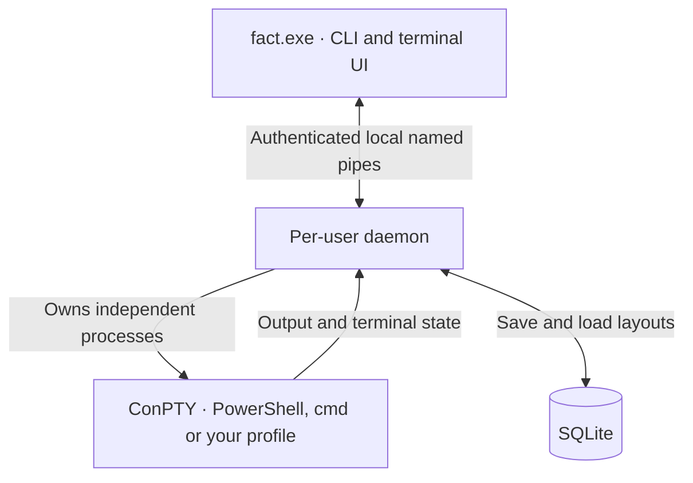

<p align="center">
  
</p>

<p align="center">
  <a href="https://github.com/imthegoodboy/FACT/actions/workflows/ci.yml"></a>
  &nbsp; <strong>Windows · Rust · MIT</strong>
</p>

<p align="center">
  <a href="#install">Install</a> ·
  <a href="#everyday-use">Get started</a> ·
  <a href="#screenshots">Screenshots</a> ·
  <a href="docs/configuration.md">Configure</a> ·
  <a href="docs/architecture.md">Architecture</a>
</p>

FACT is a Windows-native terminal multiplexer written in Rust. Real ConPTY
shells live under a per-user background daemon, so tabs, splits and grids keep
running when the UI detaches or the terminal window closes.


*One `fact --grid 8` workspace. Eight independent ConPTY shells. Each pane above
shows its actual process ID. [Explore the controls ↓](#screenshots)*

> **Status:** v0.3.3. Windows 11 is the primary, continuously tested target.
> Windows 10 1809+ is intended to work but is not yet verified; see
> [Compatibility](#compatibility). Release artifacts are produced only from
> version tags after every gate in this repository passes.

## Highlights

- **Real shells, not fake panes.** `fact --grid 8` starts eight independent
  ConPTY processes. Each pane has its own PID, terminal state, exit code and
  scrollback.
- **Survives detach.** The UI can exit while the daemon keeps shells running.
  `fact resume` reattaches to the same processes.
- **Survives a daemon restart.** The saved layout reopens with a fresh shell in
  every pane. Old screen output is discarded, never replayed, and there is no
  recovery dialog.
- **Tabs, splits and grids.** Binary split tree, focus, zoom, minimize, move and
  swap. Tiny terminals temporarily focus one pane, with `Alt+M`/`Alt+N` to
  maximize or restore the full grid at any size.
- **Minimal black TUI.** Plain terminal panes with no title rows, buttons or
  permanent status bar. A one-line tab strip appears only when a session has
  more than one tab. Panes have a scrollbar on hover in shells, a steady cursor,
  keyboard/context-menu actions, command palette, pane search, five themes and
  F1 help.
- **Local-only security.** Authenticated named pipes with a current-user DACL.
  No TCP or UDP listener, no remote access and no privileged service.
- **Scriptable CLI.** JSON output, offline session management and a `doctor`
  command that checks the installation end to end.

## Install

Releases ship a single `fact.exe`, SHA-256 checksums and PowerShell install
scripts:

```powershell
# Downloads the latest release, verifies SHA256SUMS.txt, installs per user.
powershell -ExecutionPolicy Bypass -File .\scripts\install.ps1

# Remove the program but keep sessions and configuration.
powershell -ExecutionPolicy Bypass -File .\scripts\uninstall.ps1

# Remove the program and %LOCALAPPDATA%\FACT.
powershell -ExecutionPolicy Bypass -File .\scripts\uninstall.ps1 -PurgeData
```

The installer does not require administrator rights. From a checkout, install a
locally built binary with:

```powershell
cargo build --release --bin fact
.\scripts\install.ps1 -BinaryPath .\target\release\fact.exe -Force
```

## Build from source

Requirements:

- Windows 11 (primary) or Windows 10 1809+
- Rust stable, MSVC target (`rustup default stable-x86_64-pc-windows-msvc`)
- PowerShell 7 or Windows PowerShell 5.1

```powershell
cargo build --release --bin fact
cargo run --bin fact -- --grid 4
```

## Everyday use

```powershell
fact                       # create or resume the default session
fact --grid 8              # start or reattach the dedicated grid-8 session
fact --session dev         # warm reattach, or reopen the saved layout after a restart
fact sessions              # saved, live and archived sessions
fact attach dev            # attach the TUI to a running session
fact detach                # detach every attached UI, keep shells running
fact save dev              # persist the layout immediately
fact doctor                # config, database, ACL, shell and ConPTY checks
```

Inside the TUI the default prefix is `Ctrl+Space`. Press `F1` for the full,
remappable keybinding list. `Ctrl+Space k` opens the command palette and
`Ctrl+Space /` searches the focused pane's visible screen and scrollback.

There are no per-pane buttons. Use `Ctrl+Space` then the action from F1 help, or
right-click a pane for split, maximize/show-all, minimize, restart, close and
copy. `Alt+M` maximizes the focused pane, `Alt+N` restores the full grid, and
`Alt+T` terminates the active grid after confirmation. `Ctrl+Space` then `[`
enters scroll mode for the focused pane; use arrows, PgUp/PgDn or Home/End and
press Esc to return. In a shell this browses FACT's searchable history. A
full-screen app owns its viewport, so the same gestures page the app's own
transcript. Use `Alt+N` when a narrow window would otherwise leave you in
focused-pane mode. `Ctrl+M` is Enter in terminal input, so it is not available as
a direct shortcut.
Mouse wheel scrollback works in shells. Hover near a pane's right edge to reveal
its scrollbar, then click or drag it. Moving away hides it. `Ctrl+C` copies a
selection, `Ctrl+V` pastes, and `Ctrl+Shift+C` /
`Ctrl+Shift+V` remain available alongside `Ctrl+Insert` / `Shift+Insert`.
Use `Shift`+drag to select text when an app captures the mouse. Selection holds
that pane's visible output steady while the process keeps running. `Esc`, typing,
or scrolling resumes its live view. `Shift`+right-click opens FACT's menu inside
mouse-enabled apps.

### Full-screen apps and agent CLIs

FACT adds no scrollbar to alternate-screen or mouse-controlled applications.
Agent-owned scrollbars remain under the agent's control. Terminal content uses
the full pane width; the shell history scrollbar overlays the last column only
while hovered or dragged. The wheel, Shift+wheel and `Ctrl+Space` then `[` still
browse full-screen apps, forwarding mouse reports or page keys as appropriate.

Claude Code, Codex and OpenCode use the alternate screen by default. For a true
terminal history with FACT search and a position thumb, launch them in their
main-screen/inline mode:

- **Codex:** `codex --no-alt-screen`
- **Claude Code:** run `/tui default` once to use its classic main-screen renderer
- **OpenCode:** set `OTUI_USE_ALTERNATE_SCREEN=false` before launching it

Their output then flows into FACT's scrollback instead of a private alternate
screen.

Running `fact` inside a FACT pane is rejected with a clear message instead of
nesting a second UI into the same terminal. Use a separate terminal window for a
second FACT UI; other commands such as `fact sessions` and `fact doctor` still
work inside a pane.

`--grid N` is deterministic for every explicit value, including `--grid 1`: it
starts or reattaches `grid-N` and never silently resumes an unrelated saved
session. If `grid-N` exists with a different pane count, FACT uses the next free
`grid-N-2` name. An explicit `--session NAME --grid N` is accepted when the
session is new or already has that shape; otherwise FACT asks for a new name
instead of ignoring the grid request. Running `fact` without `--grid` retains the
normal resume-latest behavior.

Session management works offline against SQLite when the daemon is not running:

```powershell
fact export dev --output .\exports
fact import .\exports\fact-dev-20261020.json --name dev-copy
fact rename dev work
fact archive old-project
fact unarchive old-project
fact delete old-project
```

`fact terminate` stops live shells while keeping the saved layout. `fact shutdown`
stops the daemon after saving every live layout. Deleting a session removes its
saved layout.

## Screenshots

These captures come from FACT running in real Windows ConPTY sessions. Click an
image to inspect it at full size. The demo uses a configured `Ctrl+B` prefix;
the default is `Ctrl+Space`. [Capture details and regeneration](docs/screenshots/README.md).

<table>
  <tr>
    <td width="50%"><strong>Find a command</strong><br>Open the palette with prefix then <code>k</code>. Type to filter, press Enter to run.</td>
    <td width="50%"><strong>Act on a pane</strong><br>Right-click for split, maximize, minimize, search and more. Click an action to run it.</td>
  </tr>
  <tr>
    <td><a href="docs/screenshots/commands.png"></a></td>
    <td><a href="docs/screenshots/pane-menu.png"></a></td>
  </tr>
</table>

**Scroll when you need it.** In a shell, hover near the pane's right edge to
reveal its scrollbar. Click or drag to browse history; move away to hide it.
FACT adds no scrollbar to alternate-screen or mouse-controlled agent UIs.


| Try it | What happens |
| --- | --- |
| `fact --grid 8` | Start or reattach an eight-pane workspace. |
| `Alt+M`, then `Alt+N` | Focus one pane, then restore the full grid. |
| Prefix then `d`, then `fact resume` | Detach and return to the same running shells. |
| Hold Shift while dragging text | Select a stable snapshot, even while an app keeps streaming. |

## Command reference

| Command | Purpose |
| --- | --- |
| `fact [--session NAME] [--grid N] [--profile NAME] [--cwd DIR]` | Create, warm-resume or reopen a saved layout and open the TUI. `--grid N` targets `grid-N`. |
| `fact resume [same options]` | Explicit form of the default command. |
| `fact attach NAME` | Attach to a session that is already live. |
| `fact sessions [--all] [--json]` | List saved and live sessions; `--all` includes archived. |
| `fact detach` | Increment the detach generation so attached UIs exit. |
| `fact doctor [--json]` | Check data directory, config, shell, database, ACLs, logs and ConPTY. |
| `fact rename OLD NEW` | Rename a live or saved session. |
| `fact save [NAME]` | Persist a live session's layout now; defaults to the most recently used live session. |
| `fact export [NAME] [--output PATH] [--stdout]` | Write versioned `fact-session` JSON. |
| `fact import FILE [--name NAME] [--overwrite]` | Import as a new saved session (fresh identity and PIDs). |
| `fact archive NAME` / `fact unarchive NAME` | Hide/restore a session; archive stops live shells. |
| `fact delete NAME [--force]` | Delete saved state; `--force` skips the live-shell confirmation. |
| `fact terminate NAME` | Stop live shells, keep the saved layout. |
| `fact stats [--json]` | Daemon uptime, panes and memory statistics. |
| `fact shutdown` | Stop the daemon after saving live layouts. |
| `fact config validate [--json]` | Parse and validate the configuration. |
| `fact config init [--force]` | Write a documented default `config.toml`. |
| `fact config path` | Print the configuration path in use. |

Global options:

- `--data-dir DIR` overrides `%LOCALAPPDATA%\FACT` (also `FACT_HOME`).
- `--config FILE` overrides `<data-dir>\config.toml`.
- `--session NAME`, `--grid N`, `--profile NAME` and `--cwd DIR` configure the
  TUI launch. Grid size is 1-32.

See [docs/configuration.md](docs/configuration.md) for every config key,
profile option, theme and default keybinding.

## How it works




The daemon is a single-owner-thread event loop. PTY output, SQLite writes,
layout changes and frame fan-out never race each other. Frames are built at a
33 ms tick and only include changed pane cells. Full details and crate
boundaries are in [docs/architecture.md](docs/architecture.md).

## Security model

- Named pipes are local (`\\.\pipe\...`) and reject remote clients.
- The listening pipe uses a protected DACL granting only the current user and
  SYSTEM, plus `FILE_FLAG_FIRST_PIPE_INSTANCE` to prevent name squatting.
- The server verifies that the connecting process belongs to the same user.
- Clients open the pipe with identification-only impersonation.
- A random 256-bit token in an ACL-protected `daemon.json` must be presented in
  the `Hello` handshake. Event-stream subscriptions use one-time tokens.
- There is no network listener and no elevation requirement.

This is a same-user boundary: any process already running as your Windows user
can read your data and act as you. See [docs/security.md](docs/security.md) for
the full threat model, protected assets and limitations.

## Data and saved layouts

The default data root is `%LOCALAPPDATA%\FACT`:

| Path | Contents |
| --- | --- |
| `config.toml` | Optional configuration. |
| `sessions.db` | SQLite sessions, pane identities and layouts. |
| `runtime\daemon.json` | Daemon identity, PID, pipe name and token. |
| `logs\daemon.log` | Append-only daemon log; `fact doctor` warns when it grows large. |
| `exports\` | Default destination for `fact export`. |

A clean shutdown saves the session layout, not the screen. On the next launch,
the saved tabs, splits and pane working directories reopen with a fresh shell in
every pane. Old output is never restored, commands are never replayed, and no
recovery modal appears. Live detach and reattach are different: they keep the
original shell processes and their scrollback untouched.

## Compatibility

- **Windows 11:** primary target; developed and tested locally. CI runs on
  GitHub's current Windows Server image, which is not Windows 11 itself.
- **Windows 10 1809+:** expected to work because FACT uses ConPTY and Win32 APIs
  available since 1809. It has not been verified on a physical Windows 10
  machine, so v0.3.3 does not claim Windows 10 support.
- **Windows on ARM:** not tested.
- **Linux/macOS:** not supported. The IPC and ConPTY layers are Windows-only.

## Development

```powershell
cargo fmt --all -- --check
cargo clippy --workspace --all-targets -- -D warnings
cargo test --workspace --no-fail-fast
```

The suite includes unit tests for every crate plus real-ConPTY integration
tests: eight independent shells, live detach/reattach with PID preservation,
fresh shells and discarded output across a daemon restart, session lifecycle,
security rejection, split/tab/search flows, the CLI command surface and a
driven TUI session. See
[docs/testing.md](docs/testing.md).

## Documentation

- [Architecture](docs/architecture.md)
- [Configuration and keybindings](docs/configuration.md)
- [Security model](docs/security.md)
- [Testing and verification](docs/testing.md)
- [Install, uninstall and releases](docs/releases.md)
- [Architecture decision records](docs/adr/README.md)

## License

MIT. See [LICENSE](LICENSE).
